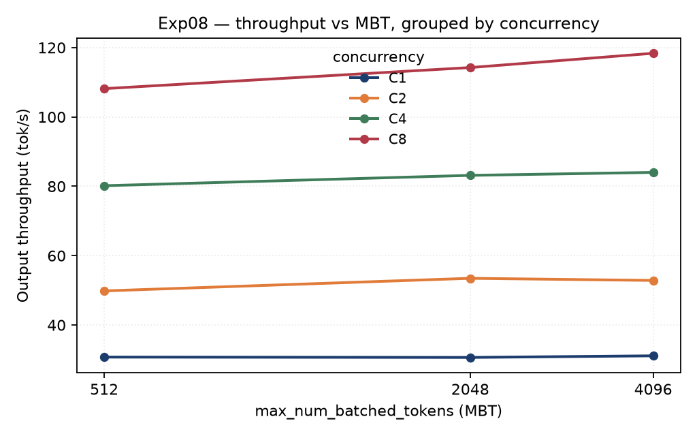

# Exp08 — MBT × Concurrency (behavioral experiment)

**Role:** behavioral observation. Establish whether the MBT effect depends on concurrency —
without claiming a mechanism.

| | |
|---|---|
| **Factors** | MBT {512, 2048, 4096} × concurrency {C1, C2, C4, C8} |
| **Fixed** | exact 2048 prompt → exact 128 completion · **APC OFF** · chunked prefill ON · `max_num_seqs=16` · `max_model_len=8192` · GPU0 220 W |
| **Design** | 3 randomized blocks · 108 executions (72 measured + 36 warmup) · 12 cells × 6 bursts |
| **Validity** | all 72 measured bursts PASS · preemption delta = 0 |
| **Headline** | C8, MBT4096 vs 2048: **TPOT −4.286%** · **req/s +3.643%** · TTFT −0.106% |



---

## Files

| File | Purpose |
|---|---|
| `runner.py` | formal campaign driver: split-plot order, server lifecycle calls, validity gating, **and aggregation into the two summary CSVs**. **No argument parser — archival reference code, not a `--help`-able CLI.** |
| `preflight.py` | pre-campaign environment / server checks |
| `configs/exp08_formal_protocol.txt` | frozen validity + interpretation rules |
| `configs/exp08_formal_preregistered_order.txt` | frozen block/MBT execution order |

Shared modules used (published once under [`../../common/`](../../common/)):

- `common/request_client.py` — the synchronized-burst client: TTFT / TPOT / ITL measurement,
  server-side token-count validation, launch-skew and preemption checks
- `common/server_lifecycle.py` — start / health-check / stop the vLLM server, capture
  `server_cmdline.txt`

---

## Design note — why split-plot

MBT is a **whole-plot** factor: changing it requires restarting the vLLM server. Concurrency is a
**sub-plot** factor randomized within each MBT server.

```
block 1 : MBT order [4096, 2048, 512]
block 2 : MBT order [2048, 512, 4096]
block 3 : MBT order [512, 4096, 2048]
```

If conditions were run in block order instead, condition and wall-clock time would be perfectly
collinear and hardware drift would masquerade as a condition effect — impossible to separate
after the fact.

---

## Validity criteria (hard, not advisory)

| # | Criterion | Where |
|---|---|---|
| 1 | `GPU0 power limit = 220 W`, recorded **while the server condition runs** | `power_boundary.json` per MBT dir |
| 2 | launch skew within a synchronized burst ≤ **25 ms** | client |
| 3 | preemption delta = 0 (from before/after `/metrics` snapshots) | client |
| 4 | completion length exactly 128 tokens (asserted) | client |
| 5 | 1 warmup burst excluded + 2 measured bursts per condition | runner |

A validity failure invalidates the affected block; runs are not cherry-picked from an invalid
block. See [`../../docs/methodology.md`](../../docs/methodology.md).

---

## What Exp08 does NOT do

It reports **no mechanism**. Any statement like "because the scheduler fragments prefill" requires
profiler or source-level evidence, which Exp08 does not have. That step is Exp12's job.

## Outputs

| Artifact | Content |
|---|---|
| `results/exp08_condition_summary.csv` | per-cell means + validity + preemptions + launch-skew stats |
| `results/exp08_relative_to_mbt2048.csv` | per-cell percentage change vs MBT2048 for each metric |

Both are written by `runner.py` itself — there is no separate analysis stage for Exp08.
