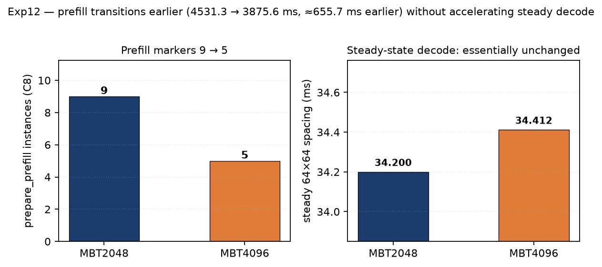

# Exp12 — Decode profiling (mechanism localization)

**Role:** profiler-based localization. Find out what changes on the GPU — and falsify the
obvious hypothesis.

| | |
|---|---|
| **Conditions** | A = C1 × MBT2048 · B = C8 × MBT2048 · C = C8 × MBT4096 |
| **Tool** | Nsight Systems 2024.5.1 · trace `cuda,nvtx,osrt` · `CuptiUseRawGpuTimestamps=false` (WSL workaround) |
| **Validity** | client `VALIDITY = PASS` · preemption 0 · kernels captured — all three conditions |

> **Profiler timing is NOT serving timing.** These traces are mechanism evidence only; they do
> not replace the unprofiled Exp08 formal serving results. Profiling adds overhead and each trace
> is an independent run.

---

## Result

| | B: C8 × MBT2048 | C: C8 × MBT4096 |
|---|---:|---:|
| `prepare_prefill` instances | **9** | **5** |
| final prefill marker (relative) | **4531.314 ms** | **3875.643 ms** |
| → difference | **≈ 655.7 ms earlier for MBT4096** | |
| steady `64x64` spacing, mean | **34.200 ms** | **34.412 ms** |
| steady `64x64` spacing, stdev | 1.120 ms | 1.104 ms |

**The falsification:** a larger MBT did **not** make steady-state decode faster. The spacing is
essentially unchanged. So the throughput gain observed in Exp08 is **not** explained by faster
decode kernels.

**What did change:** the prefill structure — fewer fragments, an earlier transition into the
decode-dominant phase.

---

## Hypothesis verdicts (`results/exp12_hypothesis_status.csv`)

| Hypothesis | Status |
|---|---|
| **H1** — C1 MBT effect is small | **NOT DIRECTLY TESTED BY EXP12** (C1 × MBT4096 was not profiled) |
| **H2** — MBT2048 is more fragmented at C8 | **SUPPORTED** (markers 9 vs 5) |
| **H3** — MBT4096 reaches stable decode earlier | **SUPPORTED** (~655.7 ms earlier) |
| **H4** — MBT4096 produces faster/tighter steady decode | **FALSIFIED for the profiled trace** · recorded as `NOT_SUPPORTED` |

> ⚠️ **Do not confuse Exp12-H4 with Exp11-H4.** Exp12-H4 was *falsified*; Exp11-H4 is
> *not established*. They are different hypotheses about different things.

---

## Files

| File | Purpose |
|---|---|
| `analyze_timeline.py` | reads the nsys-exported per-condition SQLite, counts `prepare_prefill` markers, measures `64x64` steady spacing, emits the timeline summary. **No argument parser, and its input `.sqlite` is not published — it ships as the analysis implementation (reference), not as a runnable reproducer.** |
| `profiling_commands.md` | recorded profiler settings plus a clearly labelled reconstructed invocation (the exact original command was not recorded) |
| `configs/exp12_protocol.txt` | frozen protocol |

---

## Discipline that applies here

| # | Rule |
|---|---|
| 1 | **CUDA API time ≠ GPU execution time.** `cuda_api_sum.csv` records host-side API call time; `cuda_gpu_kern_sum.csv` records GPU kernel execution. They must not be mixed. |
| 2 | **A capture existing ≠ the workload being valid.** Every profiled condition independently passes client validity (checked, not assumed). |
| 3 | **A kernel-composition change ≠ a bottleneck proof.** C1's decode region is dominated by `gemv2T` (128 instances, mean 28.918 ms); C8's by a `64x64` BF16 GEMM. That shows the **execution regime changed** — not what the bottleneck is. |
| 4 | **Kernel instance counts ≠ token counts ≠ scheduler-wave counts.** `prepare_prefill` is an iteration marker, not a cost. Do not equate its instance count with an exact scheduler-wave count. |
| 5 | **Profiler timing ≠ serving benchmark result.** |
| 6 | The **semantics** of `prepare_prefill` are inferred from naming and structure; vLLM's source was not inspected. |

---

## Power provenance (read before quoting condition comparisons)

| Condition | Contemporaneous power-boundary evidence |
|---|---|
| **C** | ✅ `results/exp12_C_power_boundary.txt` = **220.00 W** |
| **A / B** | ❌ **none recorded** → power state **UNKNOWN** |

The A/B power limit must **not** be back-inferred from other experiments or historical shell
state. This is an **evidence-completeness** gap; it does **not** invalidate the frozen Exp12
profiler workload (all three conditions passed client validity).

---

## Raw captures are not published

`*.nsys-rep` and the exported `*.sqlite` are hundreds of MB and are unusable without the matching
GPU. This directory ships the **commands**, the **workload definitions**, and the
**post-processing script** instead; the machine-readable results live in `results/`.
